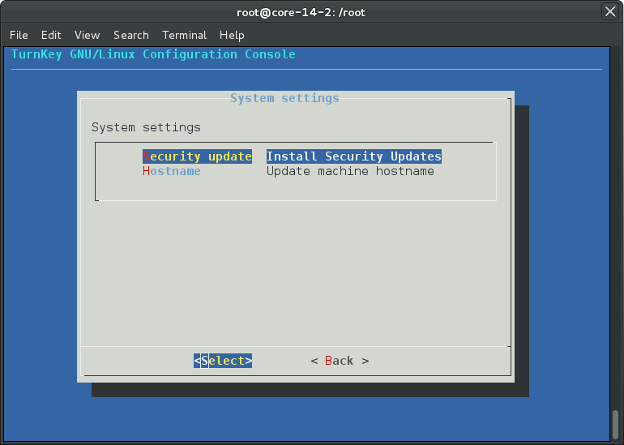

System settings
===============

.. contents::

Overview
--------

Miscellaneous system settings. Currently a bit of a "catchall" for some
functionality we wanted to include.

Security updates
----------------

Open **Security updates** in **System settings** to choose an action:

* **Security update** checks for and installs available Debian and TurnKey
  security updates for software managed by APT.
* **Secupdates adv conf** shows the current policy for handling package
  removals during automatic security updates and lets you change it.

TurnKey servers install security updates daily by default. The main screen
shows the result of the last daily run and offers **Install security updates**
if it failed. The update output appears in the terminal; on failure, press
Enter after reading the error to return to Confconsole.

From a shell, run ``sudo security-updates`` to install updates or
``sudo security-updates --status`` to inspect the daily update status and
diagnostics. A manual installation leaves the last daily result visible
until the next scheduled run.

Hostname
--------

This option allows you to manually update the system's hostname. By
default TurnKey systems have a default hostname that matches the name
of the appliance. E.g. our LAMP server has a hostname of 'lamp',
WordPress server has a hostname of 'wordpress', etc.

A hostname may consist of multiple segements/labels, separated by a
period/full-stop (i.e.: '.'). Each segment must contain only the
ASCII letters 'a' through 'z' (case-insensitive), the digits '0'
through '9', and the hyphen ('-'). No other symbols, punctuation
characters, or white space are permitted. Each segment must be no
more than 64 characters and the total hostname length must not exceed
255 characters.

Some applications may need to be restarted to note the new hostname.
Rebooting is one easy way to ensure that the new hostname is being
used everywhere.
